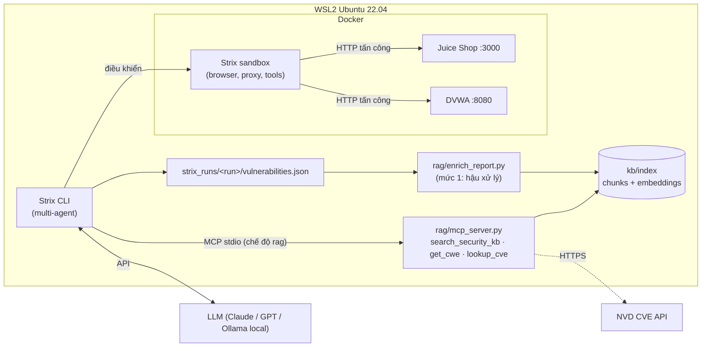

# Triển khai Strix + Web Application Security Knowledge Base (RAG)

Đồ án cuối kỳ ATTT: triển khai **Strix** (AI agent pentest mã nguồn mở) trên lab cục bộ, đánh giá hiệu quả quét, và bổ sung một **Knowledge Base RAG** gồm OWASP Cheat Sheets, OWASP WSTG và MITRE CWE, kèm tra cứu CVE trực tiếp từ NVD.

> ⚠️ Chỉ quét các ứng dụng trong lab (`targets/`). Không trỏ Strix vào hệ thống không có quyền kiểm thử.

## 1. Kiến trúc



RAG được tích hợp ở **hai mức**:

| Mức | Cách làm | Ảnh hưởng |
|---|---|---|
| 1. Hậu xử lý | `enrich_report.py` đọc báo cáo Strix, truy xuất tài liệu và để LLM viết phân tích có trích dẫn `[S#]` | Chất lượng báo cáo: root cause, khắc phục, CWE đúng, phát hiện false positive |
| 2. Trong lúc quét | MCP server `owasp_kb` được đưa vào Strix qua `--mcp-config`. Agent tự tra WSTG trước khi test và tra Cheat Sheet trước khi báo cáo | Hiệu quả quét: phương pháp test, độ phủ, loại lỗi mới (CVE) |

Ghi chú: Strix đã có sẵn 29 *skill* về lỗ hổng (`strix/skills/vulnerabilities/*.md`). KB của nhóm khác ở chỗ phạm vi rộng hơn nhiều (137 cheat sheet, 150+ trang WSTG, ~980 CWE), có trích dẫn nguồn, và cập nhật được bằng cách build lại index mà không cần sửa prompt của Strix.

## 2. Knowledge Base

| Nguồn | Vai trò | License |
|---|---|---|
| [OWASP Cheat Sheet Series](https://github.com/OWASP/CheatSheetSeries) | Phòng chống / khắc phục | CC BY-SA 4.0 |
| [OWASP WSTG](https://github.com/OWASP/wstg) | Phương pháp kiểm thử | CC BY-SA 4.0 |
| [MITRE CWE](https://cwe.mitre.org/data/downloads.html) | Phân loại điểm yếu, hậu quả, giảm thiểu | CWE Terms of Use |
| NVD CVE API (live) | Lỗ hổng mới theo sản phẩm / phiên bản | Public |

**Pipeline** ([rag/build_index.py](rag/build_index.py)):

1. Chia chunk theo heading Markdown (bỏ qua `#` nằm trong code block), gộp section ngắn hơn 250 ký tự, cắt section dài hơn 1800 ký tự và giữ lại 1 đoạn chồng lấp.
2. Gắn metadata cho mỗi chunk: `source`, `doc_title`, `section`, `url`, `vuln_types` (đặt trùng tên skill của Strix, xem [rag/taxonomy.py](rag/taxonomy.py)), `cwe`, `top10` (lấy từ `IndexTopTen.md` của OWASP), `license`.
3. Embedding: `BAAI/bge-small-en-v1.5` (384 chiều, chạy ONNX trên CPU qua fastembed, không cần GPU).
4. Truy xuất **hybrid**: dense (cosine) kết hợp BM25, hợp nhất bằng Reciprocal Rank Fusion. Mỗi tài liệu đóng góp tối đa 2 chunk để kết quả đa dạng.

## 3. RAG đóng góp gì cho quá trình test của Strix

[Strix](https://github.com/usestrix/strix) test theo luồng: **Recon → Lập kế hoạch → Khai thác từng loại lỗi → Báo cáo**. RAG cắm vào luồng này ở hai điểm:

```
Recon → Lập kế hoạch → Khai thác từng loại lỗi → Báo cáo → finish
                              │                       │
                          (RAG mức 2)             (RAG mức 2 + mức 1)
                        tra WSTG cách test      tra Cheat Sheet + CWE
                        trước khi test          trước khi báo cáo
```

### Mức 2 — trong lúc quét (MCP server `owasp_kb`, [rag/mcp_server.py](rag/mcp_server.py))

Agent của Strix gọi được các công cụ sau **ngay khi đang test**:

| Công cụ | Gọi khi nào | Đóng góp | Nguồn tri thức |
|---|---|---|---|
| `search_security_kb(source="wstg")` | Trước khi test một loại lỗi | Lấy **quy trình kiểm thử chuẩn** + gợi ý payload → test đúng cách, đỡ bỏ sót | [OWASP WSTG](https://owasp.org/www-project-web-security-testing-guide/) |
| `search_security_kb(source="cheatsheet")` + `get_cwe` | Trước khi báo cáo một finding | Xác định đúng **CWE**, **nguyên nhân gốc**, **cách khắc phục** | [OWASP Cheat Sheets](https://cheatsheetseries.owasp.org/) · [MITRE CWE](https://cwe.mitre.org/) |
| `lookup_cve` | Khi nhận diện thư viện/phiên bản | Bắt **lỗi mới** của đúng component | [NVD CVE](https://nvd.nist.gov/) |

### Mức 1 — sau khi quét ([rag/enrich_report.py](rag/enrich_report.py))

Đọc báo cáo Strix → với mỗi lỗ hổng, truy xuất tài liệu liên quan → để LLM viết lại phân tích **có trích dẫn nguồn `[S#]`** (bản chất, ảnh hưởng, khắc phục, cách kiểm chứng lại), kèm bước **đánh giá false positive** dựa trên evidence đối chiếu định nghĩa CWE.

### Tóm lại RAG đóng góp

1. **Cách test đúng chuẩn** (WSTG) — hướng dẫn agent kiểm thử từng loại lỗi.
2. **Phân loại & phân tích chính xác** — đúng CWE, đúng nguyên nhân gốc.
3. **Khắc phục có nguồn trích dẫn** — báo cáo đáng tin, không "bịa".
4. **Bắt lỗi mới** — qua tra CVE trực tiếp.
5. **Cập nhật được** — dựng lại index khi nguồn đổi, không phải sửa prompt Strix.
6. **Giảm phụ thuộc trí nhớ model** — kiến thức lấy từ nguồn tin cậy.

> **Lưu ý trung thực:** đây là đóng góp *theo thiết kế*. Về bản chất RAG thêm *kiến thức*, không thêm *năng lực thực thi* của agent — nên nhiều khả năng cải thiện **chất lượng phân tích & báo cáo** rõ hơn **số lỗi tìm ra**. Tác động thực được định lượng qua so sánh **baseline vs rag** (file `kb_tool_calls.jsonl` cho biết agent thực sự tra KB bao nhiêu lần). Tích hợp qua [Model Context Protocol](https://modelcontextprotocol.io/) nên **không phải sửa mã nguồn Strix**.

## 4. Cài đặt (đã thực hiện trên máy này)

| Thành phần | Vị trí |
|---|---|
| Docker Engine 29 (trong WSL, không dùng Docker Desktop) | `sudo service docker start` |
| Strix 1.7.0 | `~/.local/bin/strix` (cài bằng `uv tool`, Python 3.12) |
| Python venv của RAG | `~/.venvs/attt-rag` |
| RAM của WSL | `C:\Users\ADMIN\.wslconfig` → `memory=5GB` |

Chỉ cài lại khi chuyển sang máy khác:

```bash
curl -fsSL https://get.docker.com | sudo sh
sudo update-alternatives --set iptables /usr/sbin/iptables-legacy   # bắt buộc trên WSL kernel 5.10
sudo usermod -aG docker $USER && sudo service docker start
curl -LsSf https://astral.sh/uv/install.sh | sh
uv tool install --python 3.12 strix-agent
uv venv --python 3.12 ~/.venvs/attt-rag && . ~/.venvs/attt-rag/bin/activate
uv pip install -r rag/requirements.txt
bash rag/fetch_sources.sh && python rag/build_index.py
```

## 5. Sử dụng

Mở terminal Ubuntu (WSL), chạy `cd /mnt/d/cac_mon_hoc/ATTT && . ~/.venvs/attt-rag/bin/activate`, rồi:

```bash
scripts/lab.sh up                 # bật Docker + Juice Shop (localhost:3000) + DVWA (localhost:8080, admin/password)

# Tra cứu KB
python rag/query.py "JWT alg none bypass" --source wstg --brief
python rag/eval_retrieval.py      # đánh giá Hit@k / MRR: dense vs bm25 vs hybrid

# Model: model nhỏ trên Kaggle GPU (T4 x2) qua Cloudflare tunnel
scripts/kaggle_llm.sh start 8     # push kernel private, chờ tunnel, tự ghi cấu hình vào experiments/.env
scripts/kaggle_llm.sh test        # thử chat + tool calling
scripts/kaggle_llm.sh stop        # tắt khi xong (quota GPU khoảng 30 giờ/tuần)
#   (hoặc dùng API thương mại: cp experiments/.env.example experiments/.env rồi điền key)

# Một lần thực nghiệm:  <juice|dvwa> <baseline|rag> [quick|standard|deep] [budget USD]
scripts/run_scan.sh juice baseline quick 2
scripts/run_scan.sh juice rag      quick 2

# Hậu xử lý báo cáo bằng RAG
python rag/enrich_report.py experiments/strix_runs/<run> --no-llm   # chỉ gắn tài liệu tham chiếu ($0)
python rag/enrich_report.py experiments/strix_runs/<run>            # LLM phân tích có trích dẫn

# Chấm TP/FP tự động rồi tổng hợp số liệu
python experiments/auto_label.py
python experiments/collect_metrics.py
```

### Kaggle LLM server ([kaggle/llm_server.py](kaggle/llm_server.py))

```
Strix (WSL) ──HTTPS──► *.trycloudflare.com ──► auth proxy :8000 (Bearer key) ──► Ollama (2× T4)
                                                                              ├─ qwen3:14b   (agent cho Strix)
                                                                              └─ gemma3:12b  (giám khảo chấm TP/FP)
```

- Kernel ở chế độ **private**. Key ngẫu nhiên nằm trong `experiments/.kaggle_llm` (quyền 600, không commit). Gọi mà không có key thì nhận lỗi 401.
- Strix không biết context window của model nhỏ (mặc định giả định 200k), nên script đặt `STRIX_CONTEXT_FALLBACK_TOKENS=40960`, thu nhỏ ngưỡng nén context, và giới hạn độ dài output của tool.
- URL tunnel đổi mỗi lần khởi động. Chạy `scripts/kaggle_llm.sh url` để cập nhật lại `.env`.

## 6. Danh sách lỗ hổng mục tiêu (ground truth)

Đây là các lỗ hổng **đã biết** của hai ứng dụng mục tiêu, dùng làm chuẩn đối chiếu để tính **recall** và chấm TP tự động. Nguồn đầy đủ: [targets/ground_truth.json](targets/ground_truth.json).

> Lưu ý: đây **không** phải danh sách Strix chắc chắn tìm ra, mà là các lỗ hổng *có thật* trong ứng dụng. Tỉ lệ Strix phát hiện được trong số này chính là **recall** cần đo. Cột "Loại" dùng tên `vuln_type` trùng với skill của Strix (xem [rag/taxonomy.py](rag/taxonomy.py)).

### 5.1. DVWA — 15 module (mức `security=low`)

| Lỗ hổng | Loại (vuln_type) |
|---|---|
| Brute Force (đăng nhập) | authentication, weak_password_detection |
| Command Injection | rce |
| CSRF (đổi mật khẩu) | csrf |
| File Inclusion (LFI/RFI) | path_traversal_lfi_rfi, rce, ssrf |
| Unrestricted File Upload | insecure_file_uploads, rce |
| Insecure CAPTCHA | business_logic, authentication, csrf |
| SQL Injection | sql_injection |
| Blind SQL Injection | sql_injection |
| Weak Session IDs | session_management, cryptography |
| DOM XSS | xss |
| Reflected XSS | xss |
| Stored XSS | xss |
| CSP Bypass | xss, security_headers |
| Client-side JavaScript tampering | business_logic |
| Lộ trang setup / phpinfo | information_disclosure, broken_function_level_authorization |

Ngoài ra có 1 mục *generic*: thiếu security header / cờ cookie.

### 5.2. OWASP Juice Shop — 28 nhóm endpoint

| Lỗ hổng | Loại (vuln_type) |
|---|---|
| SQLi tại login | sql_injection, authentication |
| UNION SQLi tại tìm kiếm sản phẩm | sql_injection, xss |
| Xem/sửa giỏ hàng người khác | idor, broken_function_level_authorization, mass_assignment |
| Feedback: giả mạo tác giả, XSS, xóa 5 sao | idor, xss, broken_function_level_authorization, mass_assignment, business_logic |
| Đăng ký với role admin (mass assignment) | mass_assignment, broken_function_level_authorization, xss, information_disclosure |
| Lộ danh sách user / thông tin nhạy cảm | information_disclosure, broken_function_level_authorization |
| Đổi mật khẩu không cần mật khẩu cũ / CSRF | csrf, authentication, business_logic |
| Reset mật khẩu bằng câu hỏi bảo mật yếu | authentication, weak_password_detection, business_logic |
| JWT unsigned/forged, lộ token | authentication_jwt, authentication |
| Thư mục /ftp lộ file, poison null byte | information_disclosure, path_traversal_lfi_rfi, broken_function_level_authorization |
| Open redirect (bypass allowlist) | open_redirect |
| Upload: XXE, sai kích thước/loại file | xxe, insecure_file_uploads, insecure_deserialization |
| SSRF qua URL ảnh đại diện | ssrf, ssti, xss, csrf |
| NoSQL injection / giả mạo review | nosql_injection, idor, broken_function_level_authorization, mass_assignment |
| Track order: XSS / NoSQL | xss, nosql_injection |
| B2B orders: RCE / deserialization / XXE | rce, insecure_deserialization, xxe |
| Prometheus /metrics lộ ra ngoài | information_disclosure, logging_monitoring |
| Swagger /api-docs lộ API nội bộ | information_disclosure, api_security |
| Lộ khóa mã hóa / support logs | information_disclosure, cryptography, logging_monitoring |
| Truy cập trang admin / administration | broken_function_level_authorization, information_disclosure |
| Stored XSS qua header True-Client-IP | xss, header_injection |
| DOM XSS tại thanh tìm kiếm (#/search?q=) | xss |
| IDOR địa chỉ / thẻ thanh toán / đơn hàng | idor, broken_function_level_authorization, business_logic |
| Coupon / deluxe membership / logic thanh toán | business_logic, race_conditions |
| Anti-automation: captcha tại feedback | business_logic, authentication |
| Thư viện lỗi thời (package.json.bak, typosquatting) | vulnerable_components, information_disclosure |
| Chatbot / lạm dụng prompt | business_logic, llm_prompt_injection, rce |
| Photo wall / memories upload | insecure_file_uploads, xss, idor |

Ngoài ra có 2 mục *generic*: lỗi lộ stack trace, và CORS `*` / thiếu security header. Danh sách này chưa phủ hết 118 challenge của Juice Shop (xem Hạn chế ở mục 6).

## 7. Thiết kế thực nghiệm

**Biến độc lập:** chế độ (`baseline` / `rag`) × model (API lớn / model nhỏ local) × mục tiêu (Juice Shop / DVWA).
Mỗi cấu hình nên chạy ít nhất 2 lần, vì agent LLM cho kết quả khác nhau giữa các lần chạy.

| Chỉ số | Nguồn | Ý nghĩa |
|---|---|---|
| Số finding theo severity | `vulnerabilities.json` | Độ phủ |
| **Precision** = TP / (TP+FP) | `auto_label.py` (tự động) | Độ tin cậy |
| **Recall** theo danh sách lỗi đã biết | `targets/ground_truth.json` | Độ phủ trên lỗi đã biết |
| Juice Shop challenges solved | `juice_challenges.json` (snapshot sau mỗi run) | Ground truth khách quan |
| Độ nhạy / độ đặc hiệu / kappa của giám khảo | `auto_label_summary.json` | Bộ chấm tự động có đáng tin không |
| Token in/out, chi phí USD | `run.json` | Trả lời câu hỏi "có nên đầu tư mua token" |
| Thời gian | `runs.csv` | Hiệu năng |
| Số lần agent gọi KB | `kb_tool_calls.jsonl` | Agent có thực sự dùng RAG hay không |
| Hit@k / MRR | `eval_retrieval.py` | Chất lượng truy xuất |

**Gán nhãn tự động** ([experiments/auto_label.py](experiments/auto_label.py)), không có bước làm tay:

1. **DUP:** cùng endpoint (đã chuẩn hóa ID, ví dụ `/basket/5` thành `/basket/{id}`) và có chung loại lỗi với một finding trước đó.
2. **CATALOG:** khớp endpoint và loại lỗi với danh sách lỗi đã biết của DVWA (16 module) hoặc Juice Shop (30 endpoint), hoặc có challenge Juice Shop cùng nhóm được giải trong run. Những finding này tính là TP.
3. **JUDGE:** `gemma3:12b`, khác họ với model của Strix, chấm phần còn lại theo rubric chặt: chỉ tin vào evidence request/response, có kèm định nghĩa CWE lấy từ KB.
4. **Kiểm định giám khảo:** cho giám khảo chấm (a) các finding đã có nhãn CATALOG, kết quả đúng phải là TP, và (b) các **mẫu đối chứng âm** tự sinh (cùng finding nhưng evidence được thay bằng phản hồi bình thường), kết quả đúng phải là FP. Từ đó tính độ nhạy, độ đặc hiệu và Cohen's kappa. Trong báo cáo, con số này thay cho việc đối chiếu với người chấm.

**Hạn chế cần nêu trong báo cáo:** danh sách lỗi Juice Shop được tổng hợp từ tài liệu *Pwning OWASP Juice Shop*, chưa đầy đủ 118 challenge. Giám khảo LLM vẫn có thể sai, nên luôn báo cáo kèm các chỉ số kiểm định. Juice Shop và DVWA nổi tiếng nên có thể đã nằm trong dữ liệu huấn luyện của LLM. Nên bổ sung một app nhỏ tự viết, có lỗi cài sẵn, để kiểm tra khả năng tìm lỗi mà model chưa từng thấy.

## 8. Cấu trúc thư mục

```
targets/docker-compose.yml     Juice Shop + DVWA
rag/
  fetch_sources.sh             tải OWASP CheatSheetSeries, WSTG, CWE XML
  taxonomy.py                  vuln_type ↔ CWE ↔ OWASP Top 10
  build_index.py               chunk + metadata + embedding → kb/index/
  kb.py                        hybrid search (dense + BM25 + RRF)
  mcp_server.py                MCP server cho Strix (mức 2)
  enrich_report.py             hậu xử lý báo cáo (mức 1)
  query.py, eval_retrieval.py  demo và đánh giá truy xuất
scripts/lab.sh, run_scan.sh    quản lý lab, chạy thực nghiệm
experiments/                   .env, runs.csv, strix_runs/, metrics.csv, labels.csv
kb/sources, kb/index           dữ liệu nguồn và index (tạo lại được)
```

## 9. Bí mật (không commit)

| Bí mật | Vị trí |
|---|---|
| Key LLM cho Strix | `experiments/.env` |
| Token Kaggle | `~/.kaggle/access_token` (trong WSL, quyền 600) |
| Khóa SSH của máy ảo | `*.pem` — nên chuyển ra `~/.ssh/` |
## Web UI chạy Strix

Web console chạy cục bộ, không yêu cầu đăng nhập, và bind `127.0.0.1`. Python 3.10+ dùng thư viện chuẩn; có thể chạy trong WSL/Linux hoặc Windows. Khi chạy trên Windows, backend gọi WSL để thực thi Strix; khi chạy trong WSL/Linux, backend gọi `scripts/run_scan.sh` trực tiếp.

```bash
python3 web/app.py
```

Mở `http://127.0.0.1:8765`. Cấu hình Strix trong `experiments/.env`; với Juice Shop/DVWA hãy bật lab theo hướng dẫn trước khi scan. Thêm target và xác nhận quyền trước khi tạo lượt quét. Dữ liệu ứng dụng SQLite, log và report được lưu trong `web/data/` (thư mục bị gitignore).

Console gồm quản lý target/scope, scan thủ công, log trong lúc chạy, findings, lịch sử scan, lịch chạy một lần hoặc định kỳ và audit log local operator. Có thể cấu hình webhook HTTPS qua biến môi trường `STRIX_NOTIFY_WEBHOOK` để nhận thông báo khi scan xong/thất bại hoặc có finding Critical/High. Console chỉ dành cho operator trên máy cục bộ; không mở cổng ra mạng nếu chưa thêm đăng nhập/phân quyền.

Report có Risk summary và chi tiết finding theo cách trình bày gần với ZAP, gồm endpoint, CWE, confidence, evidence, impact, remediation và references nếu artifact Strix cung cấp. Dùng **Tải HTML**, **Tải JSON** hoặc **Tải Markdown**. HTML tiện đọc/in, JSON dùng tích hợp tiếp, Markdown phù hợp tài liệu kỹ thuật.
